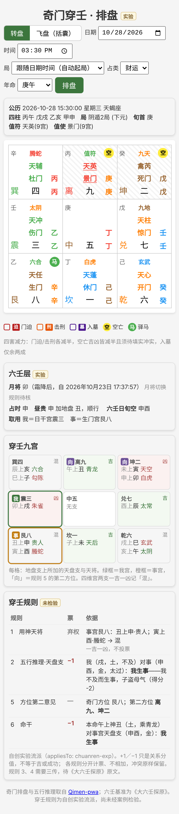

# 奇门穿壬

以奇门遁甲为框架、叠加大六壬的实验性占断应用。奇门照旧定「谁是谁、在哪一宫」，六壬给这些宫加一层读数：天盘支、十二天将、四课三传。

这是自创的实验流派。每条融合规则都要先在案例本上影子追踪、证明有效，才可写进纲要。

- 规格：[奇门穿壬 v1 · 冻结规格](https://claude.ai/artifact/QXZoZZ2tCdDzprmidLBQB6)
- 奇门部分：[kth2/Qimen-pwa](https://github.com/kth2/Qimen-pwa)（本仓库不复制、不改动它）
- 六壬基准：袁树珊《大六壬探原》卷上推演篇
- PWA：<https://kth2.github.io/Qimen-chuanren/>



## 现状

| 层 | 内容 | 状态 |
|---|---|---|
| 第一层 | 天地盘、昼夜贵人、顺逆、十二天将、九宫读数、日旬空 | 已完成，《探原》4 个原书例全部通过 |
| 月将 | 按中气切换，用 tyme4ts | 已实现，规则待核原文 |
| 规则 1、2、5、6 | 只需第一层；取用照 Qimen-pwa 五行推理 v1 | 已实现，未检验 |
| 第二层 | 四课、九法三传 | 待《探原》原文 |
| 规则 3、4 | 需要三传 | 待第二层 |
| PWA | 沿用 Qimen-pwa 样式与排盘流程，加六壬层、穿壬九宫、规则表；可离线、可装到主屏 | 已完成 |

在 600 张随机转盘上的适用率：规则 1 约 59%（其余为「混」），规则 2 约 38%（四维宫两支五行不一即弃权），规则 5 为 100%，规则 6 约 62%（给了年命时）。

## 目录

```
core/liuren/tiandipan.js   第一层：天地盘与天将（纯函数）
core/liuren/yuejiang.js    月将（中气切换，待核）
core/rules.js              规则 1、2、5、6，入口 evaluate()
web/                       PWA 页面、控制器、manifest、service worker
scripts/build.js           产出 dist/（打包 tyme4ts，从 submodule 取页面用到的文件）
scripts/smoke.js           在 jsdom 里打开 dist 页面，排转盘、飞盘各一次
vendor/qimen-pwa           Qimen-pwa（git submodule，只读引用）
test/                      《探原》原书例、与上游五行推理逐盘比对、规则测试
```

## 安装与测试

```
git clone --recurse-submodules https://github.com/kth2/qimen-chuanren
npm install
npm test
npm run build      # 产出 dist/
npm run smoke      # 冒烟测试
python3 -m http.server --directory dist   # 本地打开 http://localhost:8000
```

推到 main 后，GitHub Actions 会依次跑测试、build、冒烟，全过才部署。

界面的奇门宫格渲染函数是从 Qimen-pwa `app.js` 逐字搬来的（那边没有导出），只搬展示，不搬断法；Qimen-pwa 改了盘面样式，要同步更新 submodule 和 `web/app.js` 开头那一段。

规则 2 需要把五行推理 v1 的「宫五行」换成天盘支五行，上游没有这个参数，所以在 `core/rules.js` 里移植了打分函数。`test/rules.test.js` 用 240 张盘、每盘 81 组宫位，逐一比对移植版与上游 `WuXing.score()`，保证输入宫五行时结果完全相同。
