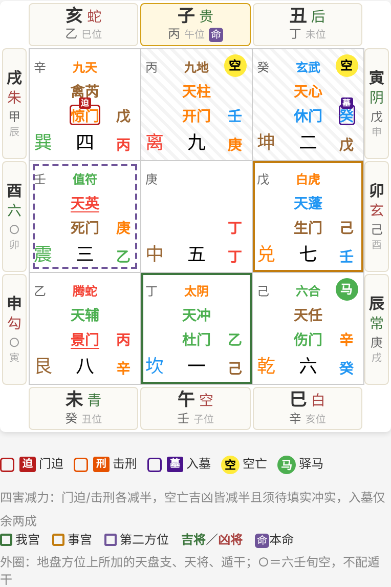

# 奇门穿壬

以奇门遁甲为框架、叠加大六壬的实验性占断应用。奇门照旧定「谁是谁、在哪一宫」，六壬给这些宫加一层读数：天盘支、十二天将、四课三传。

这是自创的实验流派。每条融合规则都要先在案例本上影子追踪、证明有效，才可写进纲要。

- 规格：[奇门穿壬 v1 · 冻结规格](https://claude.ai/artifact/QXZoZZ2tCdDzprmidLBQB6)
- 奇门部分：[kth2/Qimen-pwa](https://github.com/kth2/Qimen-pwa)（本仓库不复制、不改动它）
- 六壬基准：袁树珊《大六壬探原》卷上推演篇
- PWA：<https://kth2.github.io/Qimen-chuanren/>



## 现状

| 层 | 内容 | 状态 |
|---|---|---|
| 第一层 | 天地盘、昼夜贵人、顺逆、十二天将、九宫读数、日旬空、遁干 | 已完成：《探原》4 个原书例全部通过；与热卜同盘逐支一致；王雷之《实占百例》19 例中 18 例逐支一致（另 1 例书本身前后不一） |
| 月将 | 按中气切换，用 tyme4ts | 已实现；《探原》原文待核，但《实占百例》19 个有日期的例子全部吻合 |
| 规则 1、2、5、6 | 只需第一层；取用照 Qimen-pwa 五行推理 v1 | 已实现，未检验 |
| 九宫详解 | 每宫奇门一行（引擎解断，同 Qimen-pwa）＋六壬一行（天盘支、天将、遁干、六亲，天将×六亲象义据伍剑虹书 p84–85）；点盘上宫格可跳到该宫 | 已完成 |
| 第二层 | 四课、九宗门三传 | 已完成：取法据伍剑虹《大六壬精义讲解》，涉害取深浅法；王雷之《实占百例》62 例、伍剑虹书 19 例逐例一致（伍书一例自相矛盾，见注） |
| 规则 3、4 | 末传落宫、空亡互检 | 2026-10-28 启用，未检验 |
| PWA | 合盘：奇门九宫照 Qimen-pwa 渲染居中，外圈十二支按地盘方位排天盘支、天将、遁干（版式参照热卜）；可切「只看奇门」；可离线、可装到主屏 | 已完成 |
| AI 解读 | 用 Qimen-pwa 的 llm.js、各派纲要、旺衰、应期、五行推理，加「穿壬·六壬层」一段作旁证；设置与 Qimen-pwa 同源共用 | 已完成；Qimen-pwa 的结构化证据包尚未接入 |

在 600 张随机转盘上的适用率：规则 1 约 59%（其余为「混」），规则 2 约 38%（四维宫两支五行不一即弃权），规则 5 为 100%，规则 6 约 62%（给了年命时）。

## 目录

```
core/liuren/tiandipan.js   第一层：天地盘与天将（纯函数）
core/liuren/yuejiang.js    月将（中气切换，待核）
core/liuren/sanchuan.js    第二层：四课与三传（九宗门）
core/liuren/xiangyi.js     十二天将 × 六亲象义
core/rules.js              规则 1、2、5、6，入口 evaluate()
knowledge/liuren-candidates.json  《实占百例》萃取的候选规则（不参与求值）
web/                       PWA 页面、控制器（app.js）、AI 解读（ai.js）、manifest、service worker
scripts/build.js           产出 dist/（打包 tyme4ts，从 submodule 取页面用到的文件）
scripts/smoke.js           在 jsdom 里打开 dist 页面，排转盘、飞盘各一次
vendor/qimen-pwa           Qimen-pwa（git submodule，只读引用）
test/                      《探原》原书例、与上游五行推理逐盘比对、规则测试
```

## 安装与测试

```
git clone --recurse-submodules https://github.com/kth2/qimen-chuanren
npm install
npm test
npm run build      # 产出 dist/
npm run smoke      # 冒烟测试
python3 -m http.server --directory dist   # 本地打开 http://localhost:8000
```

推到 main 后，GitHub Actions 会依次跑测试、build、冒烟，全过才部署。

合盘里九宫比整屏窄，宫格字号改按九宫实际宽度分档（档位与字号照搬 Qimen-pwa 的屏宽档）。实测 60 张盘 × 5 个手机宽度：没有文字被裁；四害角标与邻字的重叠不多于原版。九宫窄于 322px（约 380px 以下的手机）时，与 Qimen-pwa 最窄一档同样只留四害描边、收起角标文字。

界面的奇门宫格渲染函数是从 Qimen-pwa `app.js` 逐字搬来的（那边没有导出），只搬展示，不搬断法；Qimen-pwa 改了盘面样式，要同步更新 submodule 和 `web/app.js` 开头那一段。

规则 2 需要把五行推理 v1 的「宫五行」换成天盘支五行，上游没有这个参数，所以在 `core/rules.js` 里移植了打分函数。`test/rules.test.js` 用 240 张盘、每盘 81 组宫位，逐一比对移植版与上游 `WuXing.score()`，保证输入宫五行时结果完全相同。
