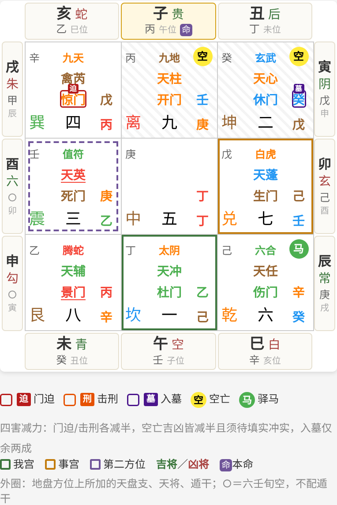

# 奇门穿壬

以奇门遁甲为框架、叠加大六壬的实验性占断应用。奇门照旧定「谁是谁、在哪一宫」，六壬给这些宫加一层读数：天盘支、十二天将、四课三传。

这是自创的实验流派。每条融合规则都要先在案例本上影子追踪、证明有效，才可写进纲要。

- 规格：[奇门穿壬 v1 · 冻结规格](https://claude.ai/artifact/QXZoZZ2tCdDzprmidLBQB6)（规则 1–6）；[v2 规格](docs/SPEC-v2.md)（规则 7–10）
- 奇门部分：[kth2/Qimen-pwa](https://github.com/kth2/Qimen-pwa)（本仓库不复制、不改动它）
- 六壬基准：袁树珊《大六壬探原》卷上推演篇
- PWA：<https://kth2.github.io/Qimen-chuanren/>



## 现状

| 层 | 内容 | 状态 |
|---|---|---|
| 第一层 | 天地盘、昼夜贵人、顺逆、十二天将、九宫读数、日旬空、遁干 | 已完成：《探原》4 个原书例全部通过；与热卜同盘逐支一致；王雷之《实占百例》19 例中 18 例逐支一致（另 1 例书本身前后不一） |
| 月将 | 按中气切换，用 tyme4ts | 已核：《探原》书页 2「每交中气，立即变更」，十二中气配将与本表一致；《实占百例》19 个有日期的例子亦全部吻合 |
| 规则 1、2、5、6 | 只需第一层；取用照 Qimen-pwa 五行推理 v1 | 已实现，未检验 |
| 案例本 | 存案例（含当时 AI 解读与各规则票）、回填实况后归档、准确率页按冻结规格计分；存在本机 IndexedDB「qimen-chuanren-casebook」，与奇门 app 分开；可导出导入 | 已完成 |
| 九宫详解 | 每宫奇门一行（引擎解断，同 Qimen-pwa）＋六壬一行（天盘支、天将、遁干、六亲，天将×六亲象义据伍剑虹书 p84–85）；点盘上宫格可跳到该宫 | 已完成 |
| 第二层 | 四课、九宗门三传 | 已完成，照《探原》核定（2026-11-05）：《探原》书页 32–46「六十花甲日三传」720 课三传与课名两栏逐课一致（test/fixtures/tanyuan-720.json 作金标；课名有 5 课表与书页 30 注之定义不合，照表并注明）。依原文更正两处：涉害上克下改数「上神所克者」（书页 9–11，「改正涉害」8 课）；伏吟癸日中取初刑、丁己辛卯日末取冲、壬辰壬午作亥辰戌／亥午子（书页 26–27，11 课）。王雷之《实占百例》62 例逐例一致；伍剑虹书 19 例中 3 例与《探原》不合（p70 昴星柔日、两例伏吟卯日），照《探原》 |
| 六壬推理 | 照《探原》卷下论断篇八门逐项讲（2026-11-05 起；伍剑虹书作参照、句首注明）：课体（《探原》课名与课体纲要，书页 30–46、78）、先锋门（占时与日干日枝之财马合害空墓冲刑破，书页 59–60）、直事门（月将入传，书页 60）、外事门／内事门（干支相加、干枝上神生克合、生旺墓绝、刑害空，书页 60–61）、发端门（用在第几课、用逢六亲、用克日辰时末年命、生旺墓绝、刑冲破害、空亡、旺相、内战外战，书页 61–63、72）、移易门、归计门（书页 61–62）、变体门（行年、本命各看上神：见月将、太岁刑、申虎、亥玄、辰戌凶将、二马、死绝、官鬼虎勾，书页 66）；占类专项（集说篇书页 84–87，按占类只列相关几节：寻人行人看存亡、老少、远近，寻人另看男女、方所；怀孕看男女；失物看新旧、高低、远近、方所；官司竞赛看胜负；婚姻看亲疏）；应期参照（书页 71–72、迟速书页 87、中黄歌书页 88）；合看：连茹间断、玄胎关隔稼穑、四局、三传生克日、朝日朝枝、如珠走盘、太岁在传、贵人顺逆（书页 62、67、79、83–84）。每句注「探原 N」「伍书 N」或「本 app 取法」；不合成总吉凶（书页 82）。不投票、不进规则账本；同一份内容进 AI 提示词与 AI 复盘条目（core/liuren/tuili.js） | 已完成 |
| 六壬白话 | 六壬推理面板顶部「先看这几条」：初传、末传、干上神对日干、应期线索（旬空、成期散期、规则 7 之支），照《探原》书页 61–63、72 所言轻重，只指出从哪里看起，不给吉凶。面板里的术语（八门、上神、四课、三传、旬空、遁干、六亲、十二天将、内外战、旺相、长生墓绝、合冲刑破害、马、行年、太岁、连茹……共 30 张卡）带虚线，点开见三层：白话（本 app 转述）、《探原》原文与书页、对照奇门（本 app 取法）；面板底部有术语白话表（core/liuren/cidian.js） | 已完成 |
| 六壬推理逐条「问」 | 六壬推理每句末有「问」：带本盘奇门盘面、穿壬段与该句的术语卡请 AI 讲这一条（意思、在本盘意味着什么、对照奇门哪一宫），三小段、三百字内，不下整盘结论；不得编造书中原话。同一句同一问句只问一次（web/ai.js explainLine） | 已完成 |
| 复盘心得（单案） | 起盘后从已做过 AI 复盘的旧案例里找六壬盘象相近的（同占类、少见课体、初传末传落空、初传天将六亲、干上神对日干、贵人冲空，逐项比，合计权重 ≥ 3），最多列三例：相同之处、当时的复盘心得、复盘点名的六壬条目，可打开该案例。标明单案、未经检验，不是规则（core/liuren/xinde.js） | 已完成 |
| 规则 3、4 | 末传落宫、空亡互检 | 2026-10-28 启用，未检验 |
| 规则 7–10（v2） | 应期融合·穿壬、类神入传、贵人互参、我彼双读；奇门、六壬两边同向才投票 | 2026-10-28 启用（不冻结），未检验；规则 7 同日改为 v2.1「奇门为主、六壬并列时决胜」，探索数字见 v2 规格；2026-11-02 改为 v2.2：事宫取 AI【用神落宫】首个在盘者（终身局、异梦按占类表），规则 8 加失物（财爻，伍剑虹书页 134）、规则 9 加股市，天气无「我」则我彼诸条弃权；2026-11-04 v2.3：规则 7 加「贵人冲空」（贵人之支冲奇门空亡宫的地支，加取为应期；〔用户所定〕，准确率页单列），AI 纪律第 12 条两路合看应期 |
| 占类 | 同奇门 app：下拉同一份清单，默认「跟随问句自动判定」（引擎 classifyQuestion），显式选择优先，实时显示判定结果与本盘别不支持的占类 | 已完成 |
| 问句方向 | 引用 Qimen-pwa Framing：检出「怕发生之事」时提示词点出、纪律第 11 条换算（照奇门 app E30 改写）；回填时预选「怕」 | 已完成 |
| 年命 | 年干 10 个；年支选填，按年干阴阳只列 6 个（规则 6 用；甲年必选，以定所遁之仪） | 已完成 |
| 行年 | 选性别即按《探原》凡例推行年（男一岁起丙寅顺行，女一岁起壬申逆行）；虚岁＝起课年柱减本命年柱（六十甲子）加一，61 岁以上勾选加六十。书中袁-4、袁-8 两例行年核对无误。只进六壬推理（变体门、存亡、发端「克年命」），不进规则投票 | 已完成 |
| 万年历 | 月历（公历、农历、节气、节日、日干支），点一天看年月日柱与十二时辰（夜子时算次日；交节当天标出交节时刻与前后年月柱）；可「用此日排盘」「设为年命」（立春当天分前后）；四柱反查：从下拉选年月日（时）干支（月柱随年干、时柱随日干只列配得上的），列出 1800–2200 年间对得上的日子与时辰（子时含前一天夜子），可直接排盘。tyme4ts，与排盘同一套 | 已完成 |
| 回填 | 同奇门 app：只写实况、选应验程度（完全／部分／未应验／结果相反），日期方位选填；是非题、盼怕、是否发生由 AI 标注员只看问句与实况代标，可手改；AI 结论方向由应验程度推出 | 已完成 |
| AI 复盘 | 已归档案例按「AI 复盘」：断错分析（照抄当时解读原句、依据、读偏在哪）、当时该怎么断（只用盘上已有条目，断不出就说）、偏差所在、单案心得；规则对错按实况确定性计算；准确率页有复盘汇总。照奇门 app 的 AI 代标与复盘反推（core/review.js） | 已完成 |
| 书中同课案例 | 王雷之 102 课、伍剑虹 33 例、袁树珊《探原》占卜一斑录 8 例（书页 100–108，日柱由书题农历推得，三传逐例核对；一例书中课图误植，按书题起课），按全同／同课／同三传列于盘下，可分类浏览、搜索 | 已完成 |
| PWA | 合盘：奇门九宫照 Qimen-pwa 渲染居中，外圈十二支按地盘方位排天盘支、天将、遁干（版式参照热卜）；可切「只看奇门」；可离线、可装到主屏 | 已完成 |
| AI 解读 | 用 Qimen-pwa 的 llm.js、各派纲要、结构化证据包（`core/reading.js` 同一份编排：象义判读、应期时间线、类象用神、力量校验、证据合流、吟局、八十一格、时格、取数、旺衰、应期、五行推理），加「穿壬·六壬层」一段作旁证（含「六壬推理」八要素，每句注书页或〔本 app 取法〕；纪律第 6 条要求引用照标、不凭天将单断）；设置与 Qimen-pwa 同源共用 | 已完成；Qimen-pwa 的结构化证据包尚未接入 |

在 600 张随机转盘上的适用率：规则 1 约 59%（其余为「混」），规则 2 约 38%（四维宫两支五行不一即弃权），规则 5 为 100%，规则 6 约 62%（给了年命时）。

## 目录

```
core/liuren/tiandipan.js   第一层：天地盘与天将（纯函数）
core/liuren/yuejiang.js    月将（中气切换，已核《探原》书页 2）
core/liuren/sanchuan.js    第二层：四课与三传（九宗门）
core/liuren/xiangyi.js     十二天将 × 六亲象义
core/casebook.js           案例记录与准确率计分（纯函数）
web/cases.js               案例本界面（存取用 Qimen-pwa 的 CaseStore，另开库）
core/rules.js              规则 1–10，入口 evaluate()
docs/SPEC-v2.md            v2 规格（规则 7–10）
knowledge/liuren-candidates.json  《实占百例》萃取的候选规则（不参与求值）
web/                       PWA 页面、控制器（app.js）、AI 解读（ai.js）、manifest、service worker
scripts/build.js           产出 dist/（打包 tyme4ts，从 submodule 取页面用到的文件）
scripts/smoke.js           在 jsdom 里打开 dist 页面，排转盘、飞盘各一次
vendor/qimen-pwa           Qimen-pwa（git submodule，只读引用）
test/                      《探原》原书例、与上游五行推理逐盘比对、规则测试
```

## 安装与测试

```
git clone --recurse-submodules https://github.com/kth2/qimen-chuanren
npm install
npm test
npm run build      # 产出 dist/
npm run smoke      # 冒烟测试
python3 -m http.server --directory dist   # 本地打开 http://localhost:8000
```

推到 main 后，GitHub Actions 会依次跑测试、build、冒烟，全过才部署。

合盘里九宫比整屏窄，宫格字号改按九宫实际宽度分档（档位与字号照搬 Qimen-pwa 的屏宽档）。实测 60 张盘 × 5 个手机宽度：没有文字被裁；四害角标与邻字的重叠不多于原版。九宫窄于 322px（约 380px 以下的手机）时，与 Qimen-pwa 最窄一档同样只留四害描边、收起角标文字。

界面的奇门宫格渲染函数是从 Qimen-pwa `app.js` 逐字搬来的（那边没有导出），只搬展示，不搬断法；Qimen-pwa 改了盘面样式，要同步更新 submodule 和 `web/app.js` 开头那一段。

规则 2 需要把五行推理 v1 的「宫五行」换成天盘支五行，上游没有这个参数，所以在 `core/rules.js` 里移植了打分函数。`test/rules.test.js` 用 240 张盘、每盘 81 组宫位，逐一比对移植版与上游 `WuXing.score()`，保证输入宫五行时结果完全相同。
